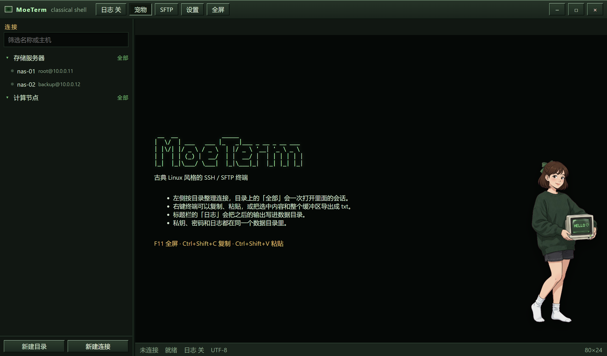

# MoeTerm

古典 Linux 风格的 Windows SSH / SFTP 终端。只做连接、传文件、记日志和导出文本。



## 功能

- 只支持 SSH，同一条连接可以开 SFTP 上传和下载
- 左侧按目录整理已保存的连接，目录上的「全部」会一次打开里面的会话
- 一键把终端输出写进日志
- 复制、粘贴，右键把选中内容或整个缓冲区导出成 txt
- 私钥和加密后的密码都放在同一个数据目录
- 可全屏。右下角的宠物可以关掉，也可以拖走

## 数据目录

默认位置：

```text
%APPDATA%\MoeTerm
```

| 路径 | 内容 |
| --- | --- |
| `tree.json` | 目录和连接，不含密码 |
| `secrets.json` | 用当前 Windows 用户 DPAPI 加密的密码和私钥口令 |
| `keys\` | 导入的私钥 |
| `known_hosts.json` | 已知主机密钥 |
| `logs\` | 终端日志 |
| `settings.json` | 字号、宠物、日志开关 |

换一台电脑时，私钥文件还在，已保存的密码需要重新填写。主机密钥第一次连接时记下，之后如果变了会拦住，需要你确认才更新。

## 开发

```powershell
npm install
npm test
npm run dev
```

## 打包

```powershell
npm test
npm run build
npm run smoke
npm run pack
```

安装包在 `release\MoeTerm Setup 1.0.0.exe`。它是每用户安装，不需要管理员权限，Windows 10 / 11 x64 可以直接安装。没有代码签名证书时，SmartScreen 可能会提示未知发布者，选择仍要运行即可。

## 许可

MIT
