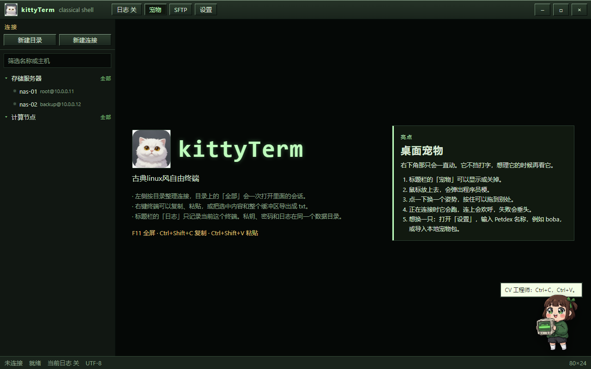
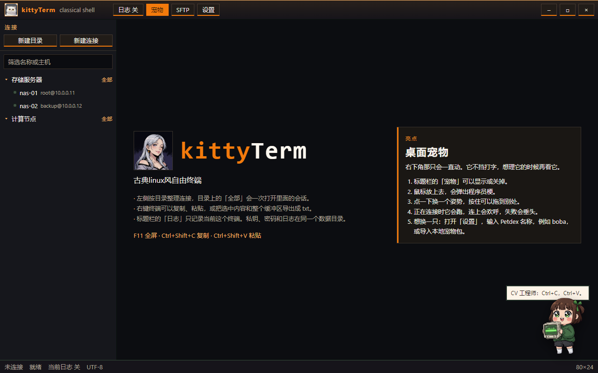
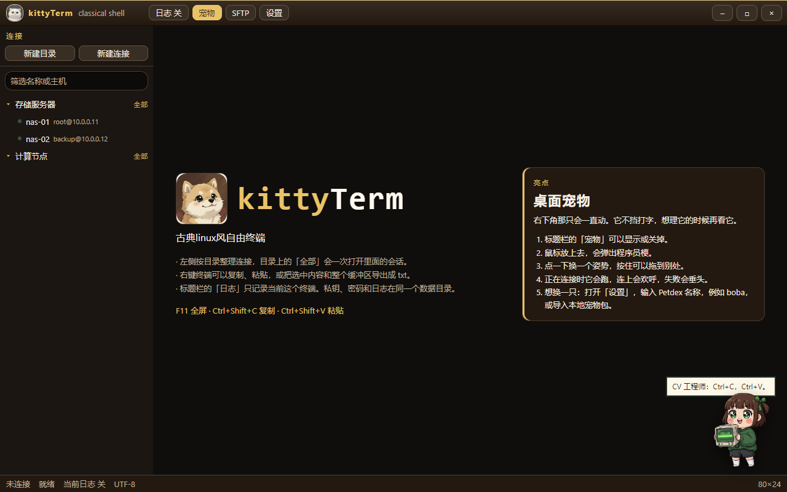
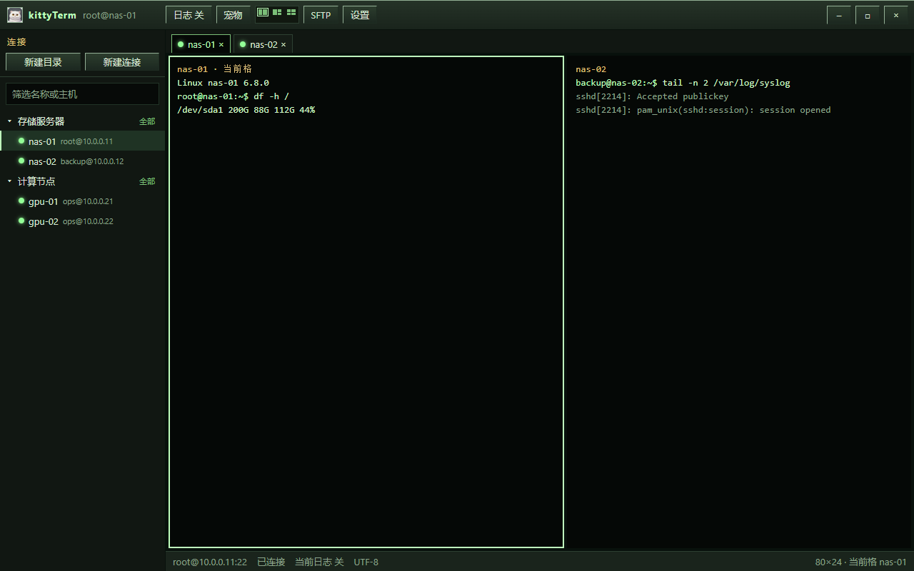
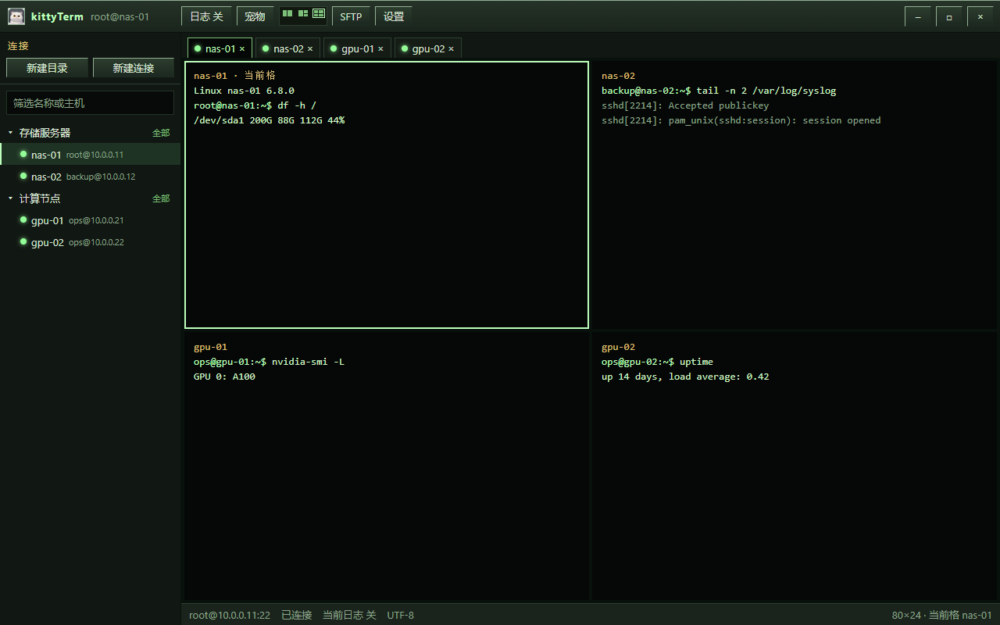

# kittyTerm

[中文](README.md) · [English](README.en.md) · [Français](README.fr.md) · [Español](README.es.md) · [日本語](README.ja.md) · [한국어](README.ko.md)

古典 Linux 风的 Windows 自由终端。用它连 SSH、传文件，再把桌面留给一只会动的宠物。

kittyTerm 只做终端该做的事：保存连接、开 Shell、用 SFTP 传文件、记下日志。窗口是深色的古典终端，标题栏上的白猫是它的标志。启动时，这只猫会带着进度从 0% 走到 100%。

[下载 Windows 安装包](https://github.com/smallyyh0721/moeterm/releases/tag/v2.0.0)



## 功能

- SSH 终端。密码或私钥登录，主机密钥第一次记住，之后变了会拦住。
- 同一条连接可以开 SFTP，上传和下载时显示进度和速度。
- 左侧按目录整理连接。目录上的「全部」会一次打开里面的会话。
- 复制、粘贴。右键把选中内容或整个缓冲区导出成 txt。
- 每个终端单独记日志。日志目录可以马上改；数据目录改完要重启。
- 分屏最多四格：左右、三格、四格。默认是单屏，打开后再分。每一格顶部有会话名称。
- 三种界面风格：古典绿、橙黑、暖棕。橙黑和暖棕的首页带有主题画像。
- 桌面宠物可以开关、拖动、换姿势。鼠标放上去会说程序员梗。也能从 Petdex 安装别的宠物，或导入本地包。
- Ctrl 加鼠标滚轮改字号。F11 全屏。
- 连接失败时，R 重试，Enter 关闭这个终端。









## 安装

安装包是 `kittyTerm Setup 2.0.0.exe`，给 Windows 10 / 11 x64。它按当前用户安装，不需要管理员。没有代码签名时，SmartScreen 可能提示未知发布者，选择仍要运行即可。

安装之后，数据默认在安装目录下的 `data` 文件夹。开发时没有安装目录，数据在 `%APPDATA%\kittyTerm`。

| 路径 | 内容 |
| --- | --- |
| `tree.json` | 目录和连接，不含密码 |
| `secrets.json` | 用当前 Windows 用户 DPAPI 加密的密码和私钥口令 |
| `keys\` | 导入的私钥 |
| `known_hosts.json` | 已知主机密钥 |
| `logs\` | 终端日志。日志目录可以改到别处 |
| `settings.json` | 字号、宠物、界面风格、日志开关 |

换一台电脑时，私钥文件还在，已保存的密码需要重新填写。数据如果还留在安装目录里，卸载程序时会一起删掉，想留下就先把数据目录改到别处。

## 开发

```powershell
npm install
npm test
npm run dev
```

打包：

```powershell
npm test
npm run build
npm run smoke
npm run pack
```

## 许可

MIT
